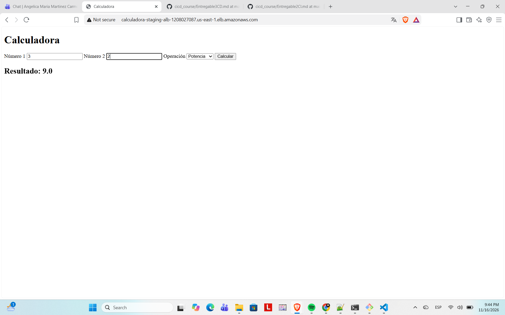
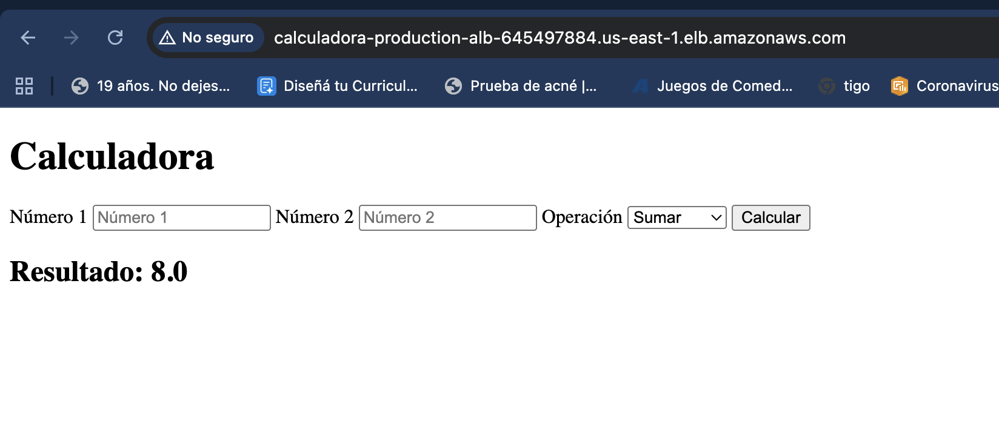
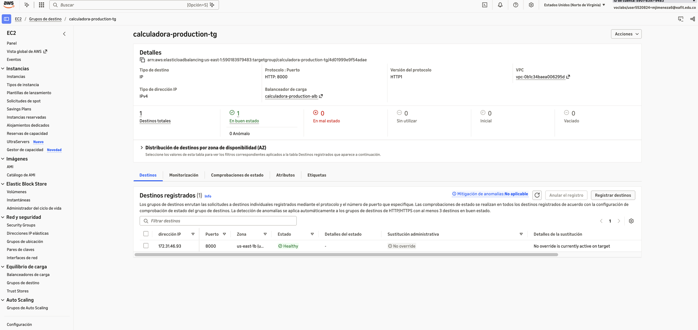

# cicd-pipeline-python-cd

## Integrantes

Manuela Jimenez Arredondo manujimeneza (Propietaria del repositorio) | David Moreno Moran davidgmoreno | Angélica Martínez Carmona amcangelica

## Evidencias

- **Ejecución del pipeline del merge de las nuevas funciones** (5 jobs en verde y aprobación de Producción): https://github.com/manujimeneza/cicd-pipeline-python-cd/actions/runs/44003319517
- **Pull Request de las nuevas funciones (potencia y módulo):** https://github.com/manujimeneza/cicd-pipeline-python-cd/pull/2
- **URLs de los ambientes:**

```plaintext
Staging:    http://calculadora-staging-alb-1208027087.us-east-1.elb.amazonaws.com
Production: http://calculadora-production-alb-645497884.us-east-1.elb.amazonaws.com
```








## Respuestas

### 1. Flujo completo del pipeline

Todo empieza cuando un cambio entra a `main` por un Pull Request aprobado. Eso dispara el workflow `ci-cd.yml`, y los jobs van en cadena: si uno falla, los demás ya no corren.

El primero es `build-and-test`, que es básicamente el CI del Taller 2. Revisa el formato con Black, saca los reportes de Pylint y Flake8, corre las pruebas unitarias y de componente (con mínimo 80 % de cobertura) y valida los archivos de Terraform. Después construye la imagen Docker con el SHA del commit como etiqueta, la levanta y le corre las pruebas de aceptación con Selenium. Si SonarCloud da el Quality Gate en verde, la imagen se publica en Docker Hub. Lo que pasa de un job a otro es justamente esa imagen con el SHA (`mjimeneza/cicd-pipeline-python-cd:<sha>`), así que lo que se despliega es lo mismo que se probó.

Luego `deploy-staging` toma las credenciales de AWS de los secretos, se conecta al estado que está en S3, se pone en el workspace `staging` y hace `terraform apply` con esa imagen. ECS crea una tarea nueva y reemplaza la anterior sin tumbar el servicio. Este job deja la URL del ALB para el siguiente.

En `test-staging` el pipeline primero espera a que `/health` responda con el SHA nuevo (para no terminar probando la versión vieja) y después corre las pruebas de aceptación con Selenium contra Staging, igual que si fuera un usuario usando la calculadora: todas las operaciones y los mensajes de error.

Ahí el pipeline se queda quieto hasta que alguien del equipo revisa Staging y aprueba el despliegue a `production`. Cuando se aprueba, `deploy-production` hace lo mismo que el de Staging pero en el workspace `production` y con la misma imagen. Por último, `smoke-test-production` hace una revisión rápida: que la página cargue y que `/health` diga `ok` con la versión que se acaba de desplegar.

### 2. Terraform frente a la consola

Lo mejor de Terraform es que la infraestructura queda escrita y guardada en Git, entonces se puede revisar en un PR y volver a crear igualita cuando se necesite. Con los mismos archivos armamos Staging y Producción, solo cambiando el workspace. También ayuda mucho ver el plan antes de aplicar, y poder borrar todo con un `terraform destroy`, que con un presupuesto de 50 dólares no es menor. Y sin esto el pipeline no podría desplegar solo.

Lo malo es que toca aprender cómo funciona HCL y el tema del estado, y cuando algo falla (un lock que quedó pegado, un recurso que "ya existe", algún permiso del Learner Lab) cuesta más entender qué pasó que si uno lo hiciera en la consola. La configuración inicial del bucket, el backend y los workspaces también toma su tiempo.

El estado va en S3 porque desplegamos desde dos lados: desde el computador y desde GitHub Actions, que cada vez usa una máquina nueva. Si el estado quedara en el computador, el pipeline no sabría que la infraestructura ya existe e intentaría crearla otra vez, y fallaría. En el bucket todos ven el mismo estado, hay bloqueo para que no se pisen dos ejecuciones y el versionado deja recuperar una versión anterior si algo se daña.

### 3. Ventajas y desventajas de Staging

La gran ventaja es poder probar la misma imagen en un ambiente igual al de Producción antes de que le llegue a alguien. Nos pasó en este taller: con el contenedor local todo funcionaba, pero en Staging las pruebas de Selenium fallaban porque Chrome intentaba abrir la página por HTTPS y el ALB solo responde por HTTP. Eso no lo habríamos visto sin Staging. Además da un lugar para que una persona pruebe antes de aprobar.

La desventaja es que cuesta el doble (cada ambiente sale más o menos a 1,2 dólares por día en AWS Academy) y el pipeline se demora varios minutos más. O sea, se pierde algo de velocidad, pero se gana bastante seguridad, porque si algo sale mal se queda en Staging y no llega a Producción.

### 4. Pruebas en Staging vs. pruebas en Producción

En Staging corren las pruebas de aceptación completas con Selenium, que abren un navegador y prueban todas las operaciones y los errores. En Producción solo corren las pruebas de humo, que son dos chequeos rápidos: que la página cargue y que `/health` responda `ok` con el SHA correcto.

Es así porque la funcionalidad ya se probó a fondo en Staging con la misma imagen. En Producción lo único que hace falta saber es que el despliegue quedó funcionando y con la versión correcta, sin meterle tráfico de pruebas pesado al ambiente que usan las personas.

### 5. Qué le falta al pipeline

Una cosa que le falta es monitoreo y alertas. Hoy solo nos damos cuenta de que algo anda mal cuando corre el pipeline, pero si la app se cae un martes a las 3 a. m. nadie se entera. Se podría hacer con alarmas de CloudWatch sobre las métricas del ALB (errores 5xx, latencia, targets `unhealthy`) y de ECS, que manden un aviso por SNS al correo o a Teams.

La otra es revisar la seguridad de las dependencias y de la imagen. SonarCloud mira nuestro código, pero no si alguna librería o la imagen base de Python tiene vulnerabilidades conocidas. Para eso se podría activar Dependabot en GitHub y agregar un escaneo con Trivy en `build-and-test` que frene el pipeline si encuentra algo crítico.

También estaría bien poner HTTPS con un certificado de ACM y usar OIDC en vez de guardar llaves de AWS en los secretos, pero eso el Learner Lab no lo deja hacer.

### 6. Experiencia implementando las nuevas funcionalidades

**Manuela Jimenez Arredondo:** Lo que más me gustó fue ver todo el recorrido: se integró el PR de potencia y módulo y el pipeline solito probó, desplegó a Staging, corrió las pruebas y se quedó esperando la aprobación para pasar a Producción, sin tener que entrar a AWS para nada. Lo que más me costó fue dejar todo andando al principio. El contenedor no mostraba el formulario porque la app tenía protección CSRF y nadie le pasaba la `FLASK_SECRET_KEY`, así que la quitamos como dice la guía y aceptamos ese issue en SonarCloud. Después las pruebas de Staging salían con la página en blanco, y resultó que Chrome intentaba entrar por HTTPS y el ALB solo atiende HTTP. Y en mi Mac, que es Intel, Homebrew no me dejó instalar AWS CLI y me tocó usar el instalador de AWS. Lo menos útil fue tener que volver a copiar las credenciales cada vez que se reiniciaba el laboratorio.

**David Moreno Moran:** Me pareció sencillo implementar potencia y módulo y ver cómo el pipeline llevó los cambios por sus distintas etapas hasta Staging y Producción. El CI/CD fue útil porque automatizó las pruebas y los despliegues, y permitió comprobar que las funcionalidades nuevas estuvieran listas antes de publicarlas. Lo menos útil me pareció tener que aprobar manualmente el paso a Producción después de que ya se ejecutaron las pruebas de aceptación; esa aprobación agrega una pausa que podría no ser necesaria en este flujo.

**Angélica Martínez Carmona:** Todo fue útil: al automatizar, se optimizan el tiempo y la calidad del despliegue.

### 7. Entrega Continua y rollback

Con la aprobación manual lo que tenemos es Entrega Continua. Cada cambio que entra a `main` se prueba y se despliega solo en Staging, así que siempre hay una versión lista, pero para que llegue a Producción alguien del equipo tiene que aprobarlo. Si fuera Despliegue Continuo, pasaría a Producción sin que nadie interviniera.

Antes de aprobar, David abrió Staging, revisó que en el menú estuvieran las operaciones nuevas y las probó: potencia (2^3 = 8.0) y módulo (7 % 3 = 1.0, y 5 % 0 muestra el error). En la aprobación dejó el comentario *"Se testearon manualmente las nuevas funcionalidades de potencia y modulo, obteniendo los resultados esperados"*.

Si una versión nueva no pasara el health check, el ALB la marcaría como `unhealthy` y no le mandaría tráfico, mientras la versión anterior sigue atendiendo. ECS intentaría levantarla varias veces y, si sigue fallando, el circuit breaker cancela el despliegue y vuelve solo a la última versión que funcionaba, sin que el servicio se caiga. En el pipeline se notaría porque el `terraform apply` termina con error, o porque el paso que espera el SHA nuevo en `/health` se cansa de esperar y falla. Si eso pasa en Staging, el pipeline se detiene ahí y la versión con problemas nunca llega a Producción.
