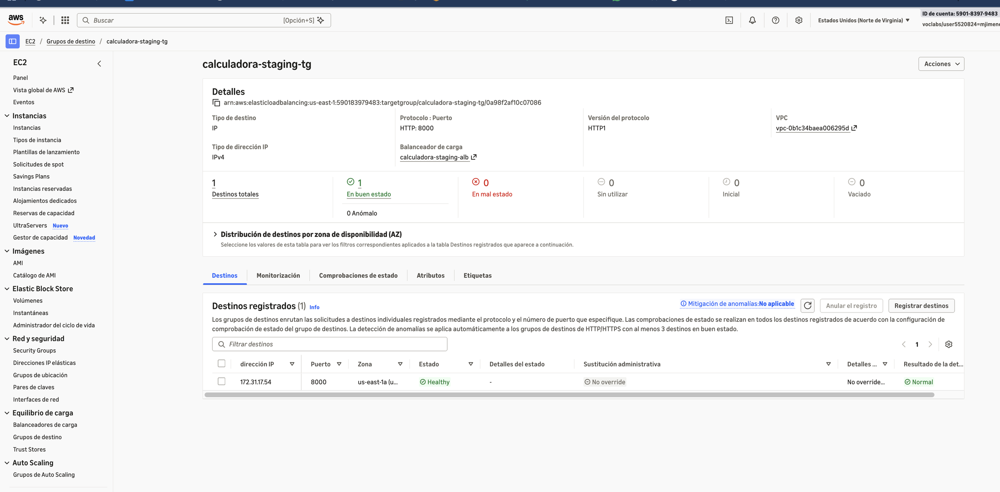

# cicd-pipeline-python-cd

## Integrantes

Manuela Jimenez Arredondo manujimeneza (Propietaria del repositorio) | David Moreno Moran davidgmoreno | Angélica Martínez Carmona amcangelica

## Evidencias

- **Ejecución del pipeline del merge de las nuevas funciones** (5 jobs en verde y aprobación de Producción): https://github.com/manujimeneza/cicd-pipeline-python-cd/actions/runs/44003319517
- **Pull Request de las nuevas funciones (potencia y módulo):** https://github.com/manujimeneza/cicd-pipeline-python-cd/pull/2
- **URLs de los ambientes:**

```plaintext
Staging:    http://calculadora-staging-alb-1208027087.us-east-1.elb.amazonaws.com
Production: http://calculadora-production-alb-645497884.us-east-1.elb.amazonaws.com
```




## Respuestas

### 1. Flujo completo del pipeline

Cada cambio integrado en `main` (mediante un Pull Request aprobado) dispara el workflow `ci-cd.yml`, que ejecuta 5 jobs en cadena; si uno falla, los siguientes no se ejecutan.

1. **`build-and-test`:** verifica el formato con Black, genera los reportes de Pylint y Flake8, ejecuta las pruebas unitarias y de componente con cobertura mínima del 80 %, valida los archivos de Terraform (`fmt -check` y `validate`), construye la imagen Docker etiquetada con el SHA del commit, la ejecuta y corre las pruebas de aceptación con Selenium contra ese contenedor, y evalúa el Quality Gate de SonarCloud. Si todo pasa, publica la imagen en Docker Hub con las etiquetas SHA y `latest`. **El artefacto que se mueve entre los jobs es la URI de la imagen con el SHA** (`mjimeneza/cicd-pipeline-python-cd:<sha>`), entregada como salida `image_uri`. Así Staging y Producción reciben exactamente la imagen que se probó.
2. **`deploy-staging`:** configura las credenciales de AWS desde los secretos, ejecuta `terraform init` contra el estado remoto en S3, selecciona el workspace `staging` y ejecuta `terraform apply` con la imagen del SHA y `APP_VERSION=<sha>`. Terraform crea una nueva revisión de la Task Definition y ECS hace un despliegue gradual sin caída. El job entrega la URL del ALB.
3. **`test-staging`:** espera a que `/health` responda con el SHA del commit (para no probar la versión anterior) y ejecuta las **pruebas de aceptación** completas con Selenium contra la URL pública de Staging: valida, como lo haría un usuario, todas las operaciones y los mensajes de error.
4. **Aprobación manual:** el job `deploy-production` usa el ambiente `production`, que tiene revisores requeridos. El pipeline se detiene hasta que un colaborador prueba Staging y aprueba.
5. **`deploy-production`:** repite el despliegue con Terraform en el workspace `production`, con la misma imagen.
6. **`smoke-test-production`:** espera a que `/health` muestre el SHA y ejecuta las **pruebas de humo**: la página principal carga y el health check responde `ok` con la versión esperada.

### 2. Terraform frente a la consola

**Ventajas:** la infraestructura queda descrita en código y versionada en Git, por lo que se puede revisar en un Pull Request y reproducir. Los mismos archivos crean Staging y Producción idénticos (cambiando solo el workspace y las variables). El plan muestra qué va a cambiar antes de aplicarlo, y `terraform destroy` elimina todo de forma controlada, lo que es clave con un presupuesto limitado. Además, permite que el pipeline despliegue sin intervención humana.

**Desventajas:** hay que aprender HCL y el modelo de estado; algunos errores (bloqueos del estado, recursos que ya existen, permisos del Learner Lab) son más difíciles de diagnosticar que en la consola, y la primera configuración (bucket, backend, workspaces) toma tiempo.

**¿Por qué el estado en S3?** Desplegamos desde dos lugares: nuestro computador y los runners de GitHub Actions, que son máquinas nuevas en cada ejecución. Si el estado quedara en el computador, el pipeline no sabría que los recursos ya existen e intentaría crearlos de nuevo, fallando con errores `already exists`. El bucket S3 es un estado compartido, con bloqueo (`use_lockfile`) para que dos ejecuciones no modifiquen la infraestructura al mismo tiempo, y con versionado para recuperar versiones anteriores del estado.

### 3. Ventajas y desventajas de Staging

**Ventajas:** permite probar la misma imagen en un ambiente igual al de Producción (mismo ALB, ECS y red) antes de que llegue a los usuarios. Detecta problemas que no aparecen con el contenedor local; por ejemplo, en nuestro caso las pruebas de aceptación fallaron en Staging porque las versiones nuevas de Chrome intentaban usar HTTPS y el ALB solo atiende HTTP. También da un lugar para que una persona valide la funcionalidad antes de aprobar.

**Desventajas:** duplica el costo de la infraestructura (en AWS Academy, aproximadamente USD 1,2 por día por ambiente) y alarga el pipeline varios minutos.

**Velocidad vs. seguridad:** se sacrifica algo de velocidad (más jobs y una aprobación) a cambio de bastante seguridad: una versión defectuosa se detiene en Staging y nunca llega a Producción.

### 4. Pruebas en Staging vs. pruebas en Producción

En **Staging** se ejecutan las **pruebas de aceptación** completas con Selenium: un navegador real recorre todas las operaciones y casos de error. En **Producción** se ejecutan solo **pruebas de humo**: dos verificaciones rápidas con la biblioteca estándar (la página carga y `/health` responde `ok` con el SHA esperado).

La diferencia se debe a que la funcionalidad ya se validó a fondo en Staging con exactamente la misma imagen. En Producción solo hace falta confirmar que el despliegue quedó vivo y con la versión correcta, de forma rápida y sin generar tráfico de prueba pesado sobre el ambiente que usan los usuarios reales.

### 5. Qué le falta al pipeline

1. **Monitoreo y alertas:** hoy solo sabemos si la aplicación funciona cuando corre el pipeline. Es importante detectar errores, lentitud o caídas en cualquier momento, antes que los usuarios. Se podría implementar con alarmas de CloudWatch sobre las métricas del ALB (errores 5xx, latencia, targets `unhealthy`) y de ECS (CPU y memoria), con notificaciones por SNS al correo o a Teams.
2. **Análisis de seguridad de dependencias e imágenes:** SonarCloud revisa nuestro código, pero no las vulnerabilidades conocidas de las librerías ni de la imagen base de Python. Se podría agregar Dependabot en GitHub para las dependencias y un escaneo de la imagen con Trivy en `build-and-test`, que falle si encuentra vulnerabilidades críticas.

Otras mejoras posibles serían HTTPS con un certificado de ACM en el ALB y el uso de OIDC en lugar de llaves de AWS en los secretos.

### 6. Experiencia implementando las nuevas funcionalidades

**Manuela Jimenez Arredondo:** Me pareció muy útil ver el flujo completo: al integrar el PR de potencia y módulo, el pipeline probó el código, desplegó a Staging, corrió las pruebas allí y solo esperó la aprobación para llegar a Producción, sin ningún paso manual en AWS. Lo más difícil fue la configuración inicial. El contenedor no mostraba el formulario porque la aplicación usaba protección CSRF y nadie le pasaba `FLASK_SECRET_KEY`, así que la quitamos como indica la guía y aceptamos el issue en SonarCloud. Después las pruebas de Staging salían con la página en blanco porque Chrome intentaba usar HTTPS y el ALB solo atiende HTTP. Además, Homebrew no pudo instalar AWS CLI en mi Mac con procesador Intel y tuve que usar el instalador oficial. Lo menos útil fue tener que renovar las credenciales de AWS Academy en cada sesión del laboratorio.

**David Moreno Moran:** _(pendiente)_

**Angélica Martínez Carmona:** _(pendiente)_

### 7. Entrega Continua y rollback

Con la aprobación manual, el pipeline implementa **Entrega Continua**: cada cambio en `main` se construye, se prueba y se despliega automáticamente en Staging, de modo que siempre hay una versión validada lista, pero el paso a Producción requiere que un revisor del ambiente `production` lo apruebe. En Despliegue Continuo, en cambio, llegaría a Producción sin intervención humana.

Antes de aprobar, David abrió la URL de Staging, comprobó que el menú tuviera las operaciones nuevas y probó potencia (2^3 = 8.0) y módulo (7 % 3 = 1.0, y 5 % 0 muestra el mensaje de error). En la aprobación dejó el comentario: *"Se testearon manualmente las nuevas funcionalidades de potencia y modulo, obteniendo los resultados esperados"*.

Si una versión nueva no pasara el health check, el ALB la marcaría como `unhealthy` y no le enviaría tráfico, mientras la tarea anterior sigue atendiendo. ECS intentaría lanzar nuevas tareas y, tras varios fallos, el **circuit breaker** marcaría el despliegue como fallido y **revertiría automáticamente** a la última versión sana, sin caída del servicio. El pipeline lo detectaría de dos formas: `terraform apply` terminaría con error, o el paso de espera de `test-staging` o `smoke-test-production` fallaría porque `/health` seguiría mostrando el SHA anterior. Si ocurre en Staging, el pipeline se detiene y la versión defectuosa nunca llega a Producción.
